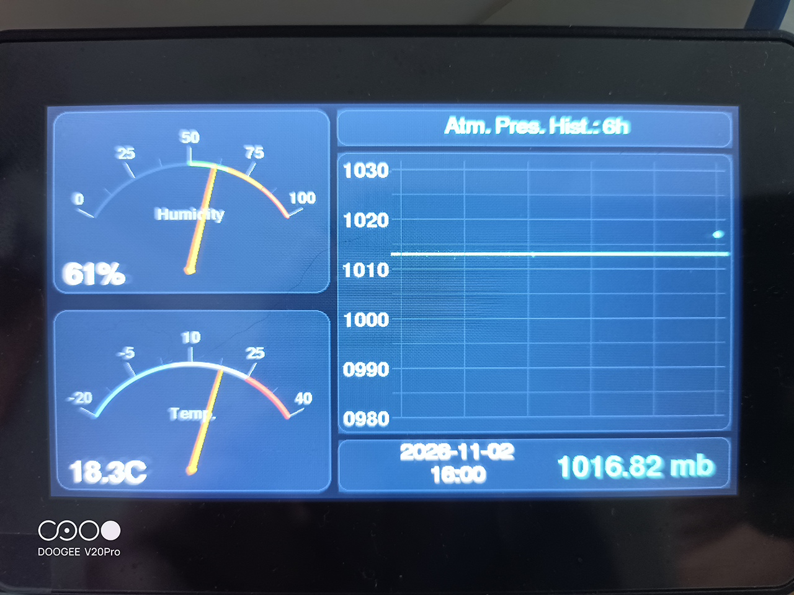
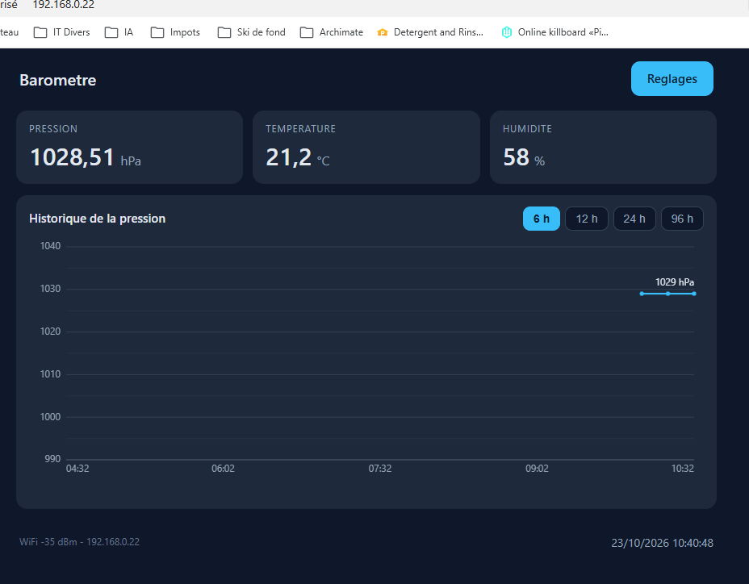

# Barómetro marino

Barómetro táctil para **ESP32-S3**: tres esferas (presión, temperatura, humedad),
tres páginas de historial a pantalla completa, interfaz web, recepción de datos
de navegación **NMEA 2000** (viento, velocidad, profundidad, rumbo), salidas
**NMEA 2000** y **NMEA 0183**, y una aplicación **Android** complementaria.

**Idioma:** [Français](README.fr.md) | [English](README.md) | Español

El proyecto funciona sobre una placa **Waveshare ESP32-S3-Touch-LCD-4.3B**
(panel a color de 800 × 480, táctil capacitivo GT911, reloj PCF85063A) con un
sensor **BME280** en el bus I²C de la placa.

## Capturas

| Pantalla de la placa | Interfaz web |
|:---:|:---:|
|  |  |

*La misma medida en ambos lados: las esferas y el historial de presión en la
placa, los valores en directo y el gráfico en la página web.*

## Contenido

- [Capturas](#capturas)
- [Características](#características)
- [Material](#material)
- [Compilación](#compilación)
- [Dependencias](#dependencias)
- [Configuración de TFT_eSPI](#configuración-de-tft_espi)
- [Uso de la pantalla](#uso-de-la-pantalla)
- [Interfaz web](#interfaz-web)
- [Aplicación Android](#aplicación-android)
- [Tarjeta SD](#tarjeta-sd)
- [Salidas NMEA](#salidas-nmea)
- [Estructura del proyecto](#estructura-del-proyecto)
- [Notas técnicas](#notas-técnicas)
- [Licencia](#licencia)

## Características

### Pantalla

- Tres esferas analógicas: presión, temperatura y humedad.
- Barra de información: fecha, hora y presión instantánea.
- Tres páginas de historial a pantalla completa (humedad, temperatura, presión),
  abiertas tocando la esfera correspondiente y cerradas tocando en cualquier
  lugar. Tocar el gráfico de presión abre el historial de presión.
- Ventana de historial común a las tres series: **6 h, 12 h, 24 h, 48 h o 96 h**.
  El eje de tiempos cubre exactamente la duración elegida, con un punto cada
  15 min.
- Escala de temperatura fija (−20 → 40 °C, o −4 → 104 °F en Fahrenheit), escala
  de presión flotante sobre 50 hPa — la misma que la página web — con la presión
  estándar **1013 hPa** marcada por una **línea verde** (página de medida,
  historial a pantalla completa y página web).
- Suspensión de la pantalla tras 5 min sin tocar; el primer toque la despierta y
  vuelve a la página de medida. Al despertar, el panel se reinicializa
  automáticamente para volver a colocar la imagen (véase «Restart Screen»).
- Menú táctil: unidad de temperatura, ventana de historial, configuración NMEA,
  fecha y hora, reinicio de la pantalla, salir.

### Interfaz web

- Valores en directo y **tres gráficos de historial** (presión, temperatura,
  humedad), seleccionados pulsando la tarjeta correspondiente. Duraciones:
  **6 / 12 / 24 / 48 / 96 h** a 15 min, con la misma escala de presión que la
  pantalla y la línea verde a 1013 hPa.
- Interfaz **bilingüe francés / inglés**, elegida en la página de ajustes; la
  elección se guarda en memoria y solo afecta a la página web (la pantalla de la
  placa permanece en inglés).
- Página de ajustes: idioma, reinicio de la pantalla (sin perder el historial),
  reinicio de la placa, unidad de temperatura, velocidad NMEA 0183, corrección de
  calibración de la humedad, red WiFi, fecha y hora, estado de la tarjeta SD.
- Conexión a la red doméstica, con un punto de acceso de reserva automático si la
  red no está disponible. Ajustes guardados en NVS (memoria flash) y recargados
  al arrancar.
- Página **Navegación** (`/nav`): esferas circulares de **viento** (velocidad y
  dirección, con conmutación verdadero / aparente) y de **rumbo** (rumbo
  verdadero / rumbo sobre el fondo), velocidad sobre el fondo y sobre el agua, y
  profundidad — alimentadas por los datos recibidos del bus NMEA 2000.

### NMEA

- **NMEA 2000** en el bus CAN: PGN 130312 y 130316 (temperatura), 130313
  (humedad) y 130314 (presión), enviados una vez por segundo.
- **NMEA 0183** en el puerto RS485: sentencia `$WIXDR` (humedad, temperatura,
  presión) cada 10 s, velocidad configurable de 4800 a 38400 baudios, o salida
  desactivada.
- Los valores NMEA permanecen siempre en unidades métricas (°C, %, bar), incluso
  cuando la pantalla está configurada en Fahrenheit.
- **Recepción NMEA 2000**: el barómetro escucha el bus y actualiza los datos de
  navegación mostrados en la página «Navegación» — viento (velocidad y dirección,
  aparente y verdadero), velocidad sobre el fondo y sobre el agua, profundidad,
  rumbo y rumbo sobre el fondo (véase «Salidas NMEA»).

## Material

| Elemento | Detalle |
|---|---|
| Placa | Waveshare ESP32-S3-Touch-LCD-4.3B (ESP32-S3, 16 MB de flash, PSRAM OPI) |
| Panel | RGB 800 × 480, controlado por `ESP32_Display_Panel` |
| Táctil | GT911 (I²C), expansor CH422G para retroiluminación y entradas |
| Sensor | BME280 (presión, temperatura, humedad) en el bus I²C interno |
| Reloj | PCF85063A (0x51) en la placa, o DS3231 (0x68); si no, reloj por software |
| NMEA 0183 | RS485, GPIO 44 (TX) y 43 (RX) |
| NMEA 2000 | CAN mediante TWAI, GPIO 15 (TX) y 16 (RX), transceptor CAN externo |

## Compilación

### Obtener el proyecto

```bash
git clone https://github.com/Soleiado/Barometre_marin.git
```

### Arduino IDE

1. Instalar el núcleo **esp32** (3.3.12 probado) desde el gestor de placas,
   añadiendo la URL
   `https://espressif.github.io/arduino-esp32/package_esp32_index.json`.
2. Instalar las bibliotecas listadas más abajo.
3. Seleccionar la placa **ESP32S3 Dev Module** con:
   - **Flash Size**: 16 MB
   - **PSRAM**: OPI PSRAM
   - **Partition Scheme**: 3 MB APP / 9 MB FAT
4. Abrir `Barometre_marin.ino` y subirlo.

El archivo `build_opt.h` del proyecto es necesario: define
`CONFIG_SPIRAM_SUPPORT`, símbolo que TFT_eSPI 2.5.43 aún comprueba para asignar
los sprites en PSRAM (sin él, no se puede crear el lienzo de 800 × 480).

### arduino-cli

```bash
arduino-cli core install esp32:esp32@3.3.12

arduino-cli compile \
  --fqbn "esp32:esp32:esp32s3:FlashSize=16M,PSRAM=opi,PartitionScheme=app3M_fat9M_16MB" \
  --output-dir build .

arduino-cli upload -p COM8 \
  --fqbn "esp32:esp32:esp32s3:FlashSize=16M,PSRAM=opi,PartitionScheme=app3M_fat9M_16MB" \
  --input-dir build .
```

## Dependencias

Versiones con las que el proyecto fue compilado y probado:

| Biblioteca | Versión | Función |
|---|---|---|
| `esp32:esp32` (Arduino-ESP32) | 3.3.12 | Núcleo ESP32-S3 (IDF 5.4), WiFi, WebServer, Preferences, TWAI |
| [ESP32_Display_Panel](https://github.com/esp-arduino-libs/ESP32_Display_Panel) | 1.0.4 | Panel RGB, táctil GT911 y controlador CH422G |
| [esp-lib-utils](https://github.com/esp-arduino-libs/esp-lib-utils) | 0.3.0 | Requerido por ESP32_Display_Panel |
| [ESP32_IO_Expander](https://github.com/esp-arduino-libs/ESP32_IO_Expander) | 1.1.1 | Requerido por ESP32_Display_Panel (CH422G) |
| [TFT_eSPI](https://github.com/Bodmer/TFT_eSPI) | 2.5.43 | Lienzo de dibujo de 800 × 480 en PSRAM |
| [TFT_eWidget](https://github.com/Bodmer/TFT_eWidget) | 0.0.5 | Botones y campos del menú táctil |
| [NMEA2000](https://github.com/ttlappalainen/NMEA2000) | 4.24.1 | Pila NMEA 2000 |
| [NMEA2000_esp32](https://github.com/ttlappalainen/NMEA2000_esp32) | 1.0.3 | Controlador CAN TWAI (`NMEA2000_esp32_twai`) |

Las demás bibliotecas usadas (`WiFi`, `WebServer`, `ESPmDNS`, `Preferences`,
`SPI`, `driver/i2c`) vienen con el núcleo esp32.

Instalación en un solo comando:

```bash
arduino-cli lib install \
  "ESP32_Display_Panel@1.0.4" \
  "esp-lib-utils@0.3.0" \
  "ESP32_IO_Expander@1.1.1" \
  "TFT_eSPI@2.5.43" \
  "TFT_eWidget@0.0.5" \
  "NMEA2000@4.24.1" \
  "NMEA2000_esp32@1.0.3"
```

> La carpeta de bibliotecas del proyecto **no** contiene modificaciones locales:
> son las versiones publicadas, sin cambios.

## Configuración de TFT_eSPI

TFT_eSPI no controla el panel (`ESP32_Display_Panel` lo hace): solo proporciona
la superficie de dibujo. Aun así debe configurarse, de lo contrario las fuentes
y los colores no coinciden.

Copiar `extras/TFT_eSPI_User_Setup.h` sobre el archivo `User_Setup.h` de la
carpeta de la biblioteca TFT_eSPI. Las líneas importantes:

```c
#define ST7796_DRIVER      // geometría de referencia, el lienzo se crea a 800x480
#define TFT_BL   5
#define SPI_FREQUENCY  27000000
#define LOAD_GLCD
#define LOAD_FONT2         // etiquetas pequeñas
#define LOAD_FONT4         // texto normal
#define LOAD_FONT6         // dígitos grandes
#define LOAD_FONT7
#define LOAD_FONT8
#define LOAD_GFXFF
#define SMOOTH_FONT
```

## Uso de la pantalla

| Zona táctil | Efecto |
|---|---|
| Barra gris abajo a la derecha | abre / cierra el menú |
| Esfera de humedad (arriba) | historial de humedad a pantalla completa |
| Esfera de temperatura (abajo) | historial de temperatura a pantalla completa |
| Gráfico de presión | historial de presión a pantalla completa |
| Cualquier punto de un historial | vuelta a la página de medida |

El menú permanece abierto hasta **Exit**. Sus entradas:

| Entrada | Contenido |
|---|---|
| Temp. Unit | Celsius / Fahrenheit (el asterisco marca la elección actual) |
| Hist. Range | 6 h / 12 h / 24 h / 48 h / 96 h |
| NMEA Config. | solo N2K, o NMEA 0183 a 4800 / 9600 / 19200 / 38400 baudios |
| Date & Time | ajuste del reloj (día, mes, año, hora, minutos) |
| Restart Screen | reinicia el panel sin perder el historial (véase más abajo) |
| Exit | vuelta a la página de medida |

## Interfaz web

Una vez configurado el WiFi, la página está disponible en
**http://barometre.local/** o en la dirección IP de la placa. Sin una red
conocida, la placa crea el punto de acceso **Barometre** / **barometre123**
(**http://192.168.4.1/**), donde la misma página permite introducir las
credenciales de la red doméstica.

| Página | Contenido |
|---|---|
| `/` | valores actuales, gráfico de historial, enlace a los ajustes |
| `/nav` | esferas de viento y rumbo, velocidades y profundidad (datos recibidos del bus NMEA 2000) |
| `/params` | idioma, pantalla, unidades, salida NMEA, red WiFi, fecha y hora, estado de la tarjeta SD |
| `/wifi` | introducción del SSID y la contraseña (reinicia la placa) |

### API JSON

| Ruta | Método | Parámetros | Respuesta |
|---|---|---|---|
| `/api/data` | GET | — | presión, temperatura, humedad, unidad, modo de historial, hora, estado WiFi |
| `/api/nav` | GET | — | datos de navegación recibidos (viento, velocidades, profundidad, rumbo) |
| `/api/history` | GET | `h=6\|12\|24\|48\|96` | series de presión / temperatura / humedad, escalas, marca de tiempo |
| `/api/diag` | GET | — | diagnóstico del panel y de la red (imágenes, bloqueos, memoria libre, PSRAM, RSSI) |
| `/api/panel` | GET | `display=1`, `restart=1`, `reboot=1`, `pclk=<Hz>` | acciones sobre el panel |
| `/api/radio` | GET | `tx=<dBm>`, `sleep=0\|1` | potencia de emisión y ahorro de energía WiFi |
| `/time` | POST | `dt=AAAA-MM-DDTHH:MM` | ajuste del reloj |
| `/save` | POST | `ssid`, `pass` | guardar la red y reiniciar |

Ejemplo:

```bash
curl "http://barometre.local/api/data"
{"ok":1,"p":1028.13,"t":19.2,"h":61,"fh":0,"mode":6,"time":"23/10/2026 08:41:03","sta":1,"ip":"192.168.0.22","rssi":-35}
```

### Ajustes guardados

Guardados en NVS (espacio de nombres `baro`) y recargados al arrancar:

| Clave | Contenido |
|---|---|
| `ssid`, `pass` | red WiFi |
| `lang` | idioma de la interfaz web (0 = francés, 1 = inglés) |
| `fah` | unidad de temperatura (Fahrenheit si es verdadero) |
| `nmea` | velocidad NMEA 0183 (0 = solo N2K) |
| `humcal` | corrección de calibración de la humedad (en %) |
| `LastNodeAddress` | dirección de nodo NMEA 2000 |

## Aplicación Android

Una aplicación **Android** complementaria (en la carpeta `android/`) muestra la
interfaz web del barómetro exactamente igual: es una envoltura nativa que abre
la página en una WebView. No se vuelve a codificar ningún gráfico — las páginas
mostradas son las servidas por el barómetro.

- **Detección automática**: al iniciarse, la aplicación busca el barómetro en la
  red local (mDNS `barometre.local`). Si falla, ofrece introducir la dirección
  (nombre de host o IP).
- **Dirección recordada**: la última dirección se conserva y se reutiliza en el
  siguiente arranque; un botón «Conectar» reinicia la búsqueda o cambia de
  barómetro.
- **Requisitos**: Android 8.0 o posterior (minSdk 26). El barómetro y el
  teléfono deben estar en la misma red local.

### Compilar la aplicación

Desde la carpeta `android/`, con un JDK 17+ y el SDK de Android:

```bash
./gradlew assembleDebug      # APK de depuración
./gradlew assembleRelease    # APK release firmado (requiere keystore.properties)
```

Los APK se generan en `app/build/outputs/apk/`. El APK de depuración puede
instalarse directamente (`adb install` o copiándolo al teléfono). El APK release
se firma con una clave privada referenciada por un archivo local
`keystore.properties` (no versionado). El proyecto usa Gradle 9.7.1 y AGP 9.4.1
(Kotlin integrado).

### Descarga

Un APK release firmado y listo para instalar se publica como
[release de GitHub](https://github.com/Soleiado/Barometre_marin/releases):

- [**Barometre-marin-v1.0.0.apk**](https://github.com/Soleiado/Barometre_marin/releases/download/v1.0.0/Barometre-marin-v1.0.0.apk)

Puede ser necesario permitir «instalar aplicaciones de fuentes desconocidas» en
los ajustes de Android antes de instalar el APK directamente.

## Tarjeta SD

La ranura microSD (TF) archiva las medidas. **En cuanto hay una tarjeta presente,
el registro se activa automáticamente** (sin ajuste manual); el estado se muestra
en la página de ajustes.

- **Formato**: tarjeta **FAT32** (o FAT16 para tarjetas ≤ 2 GB). exFAT y NTFS no
  son compatibles.
- **Archivos**: un archivo por día, llamado `AAAAMMJJ.csv`, con una línea añadida
  cada 15 minutos:
  ```
  202610251430,1029.8,17.9,46
  ```
  es decir `fecha/hora (AAAAMMJJHHMM), presión (mb), temperatura (°C), humedad (%)`,
  separador coma, decimales con punto.
- **Tarjeta llena**: cuando la tarjeta alcanza el 90 % de uso, se elimina el
  archivo más antiguo (comprobado una vez al día).
- **Recuperación tras un corte de corriente**: al arrancar, si hay una tarjeta y
  el reloj ha conservado la hora, el historial se reconstruye desde el CSV. Según
  la diferencia con la última medida: **menos de 15 min** → el siguiente registro
  se alinea con el último; **entre 15 min y 1 h** → la diferencia se simula con el
  último valor; **más de 1 h** → el historial vuelve a empezar.
- La ranura TF está conectada por **SPI** (MOSI = GPIO 11, SCK = GPIO 12,
  MISO = GPIO 13), siendo el chip-select la salida **EXIO4** del expansor CH422G.

## Salidas NMEA

| Salida | Soporte | Contenido | Periodo |
|---|---|---|---|
| NMEA 2000 | CAN / TWAI, GPIO 15 (TX) y 16 (RX) | PGN 130312 y 130316 (temperatura, rango extendido), 130313 (humedad), 130314 (presión) | 1 s |
| NMEA 0183 | RS485, GPIO 44 (TX) y 43 (RX) | `$WIXDR`: humedad, temperatura del aire, presión barométrica | 10 s |

Ejemplo de sentencia NMEA 0183:

```
$WIXDR,H,61.0,P,AirHumidity,C,19.2,C,AirTemp,P,1.0281,B,Barometer*03
```

### Recepción NMEA 2000

El barómetro escucha el bus y actualiza la página «Navegación» a partir de estos
PGN:

| PGN | Dato |
|---|---|
| 130306 | viento (velocidad y dirección, aparente y verdadero) |
| 128259 | velocidad sobre el agua (STW) |
| 128267 | profundidad |
| 129026 | rumbo sobre el fondo y velocidad sobre el fondo (COG / SOG) |
| 127250 | rumbo verdadero |

## Estructura del proyecto

```
Barometre_marin.ino                 setup(), loop(), páginas, menú, zonas táctiles
screen.cpp / screen.h               panel RGB, lienzo TFT_eSPI en PSRAM, táctil, suspensión
meter.cpp / meter.h                 esferas analógicas (aguja, zonas de color)
barometer.cpp / barometer.h         series de historial, gráficos, página de medida
menu.cpp / menu.h                   botones y formularios táctiles
webui.cpp / webui.h                 servidor HTTP, páginas HTML, API JSON
nmea.cpp / nmea.h                   salida NMEA 0183 (RS485)
nmea2k.cpp / nmea2k.h               salida NMEA 2000 (CAN / TWAI) y recepción de datos de navegación
navdata.cpp / navdata.h             datos de navegación recibidos del bus NMEA 2000
sdlog.cpp / sdlog.h                 registro de medidas en la tarjeta SD
rtc_clock.cpp / rtc_clock.h         PCF85063A, DS3231 o reloj por software
bme280_local.cpp / bme280_local.h   controlador BME280 propio (I2C, fórmulas de Bosch)
i2c_bus.cpp / i2c_bus.h             bus I²C compartido (controlador heredado, requerido por ESP32_Display_Panel)
datetime_local.h                    tipo DateTime mínimo (evita la dependencia de RTClib)
Definition.h                        constantes: retardos, rangos, números de página
theme.h                             paleta de pantalla «instrumento marino»
esp_panel_board_supported_conf.h    selección de placa para ESP32_Display_Panel
build_opt.h                         opción de compilación (lienzo en PSRAM)
extras/TFT_eSPI_User_Setup.h        configuración TFT_eSPI usada
android/                            aplicación Android complementaria (WebView, descubrimiento mDNS)
docs/                               capturas usadas por esta documentación
README.md / README.fr.md / README.es.md   esta documentación, en inglés, francés y español
```

## Notas técnicas

**Desplazamiento vertical de la imagen.** El panel RGB puede desplazarse unos
cien píxeles cuando el bus de memoria queda bloqueado demasiado tiempo (escritura
en flash, ráfaga WiFi, copia del lienzo). Medidas tomadas para evitarlo: PCLK a
16 MHz, un búfer de rebote de 20 líneas en RAM interna, invalidación de la caché
de ese búfer, y la copia del lienzo dividida en porciones de 8 líneas. Además se
pide una resincronización automática en cuanto un refresco tarda anormalmente, y
la imagen puede recolocarse sin perder nada, desde el menú táctil (**Restart
Screen**) o mediante `/api/panel?display=1`. Al despertar de la suspensión se
activa automáticamente este restablecimiento.

**Historial en RAM.** Las series de historial viven en RAM y se pierden en cada
reinicio: un único búfer de 384 medidas (96 h a razón de una medida cada 15 min)
por magnitud, del que las vistas 6 / 12 / 24 / 48 / 96 h son ventanas
deslizantes. Sin escritura periódica en flash, lo que evitaría interrumpir el
refresco del panel; el archivado a largo plazo pasa por la tarjeta SD (véase más
arriba).

**Lienzo en PSRAM.** Toda la interfaz se dibuja en un sprite TFT_eSPI de
800 × 480 píxeles (768 KB) colocado en PSRAM, y luego se copia al búfer del panel.

**WiFi y el panel.** La transmisión WiFi perturba el panel: la potencia se reduce
a 8,5 dBm y se usa el ahorro de energía `WIFI_PS_MAX_MODEM`. La latencia de la
página web aumenta ligeramente (unos 0,4 s), lo que sigue siendo cómodo.

**Sin caracteres acentuados en el código.** Las fuentes embebidas y la maquetación
están pensadas para ASCII, por lo que los textos en pantalla evitan los caracteres
acentuados.

**Interfaz web bilingüe.** Cada página se escribe una sola vez: los textos se
reemplazan al enviarlos (página principal) o se leen de una tabla francés/inglés
para las páginas construidas dinámicamente. Ninguna página se duplica en el
binario.

**Controlador BME280 propio.** El sensor se lee mediante un pequeño controlador
dedicado (solo I2C): el bus lo posee el controlador «legacy» de ESP-IDF instalado
por ESP32_Display_Panel, con el que `Wire` no puede coexistir. Las fórmulas de
compensación son las publicadas por Bosch Sensortec (BSD-3-Clause, copyright
conservado en `bme280_local.cpp`); el resto del controlador está bajo MIT, como el
proyecto.

## Licencia

Publicado bajo la licencia **MIT**. Véase el archivo [LICENSE](LICENSE).
