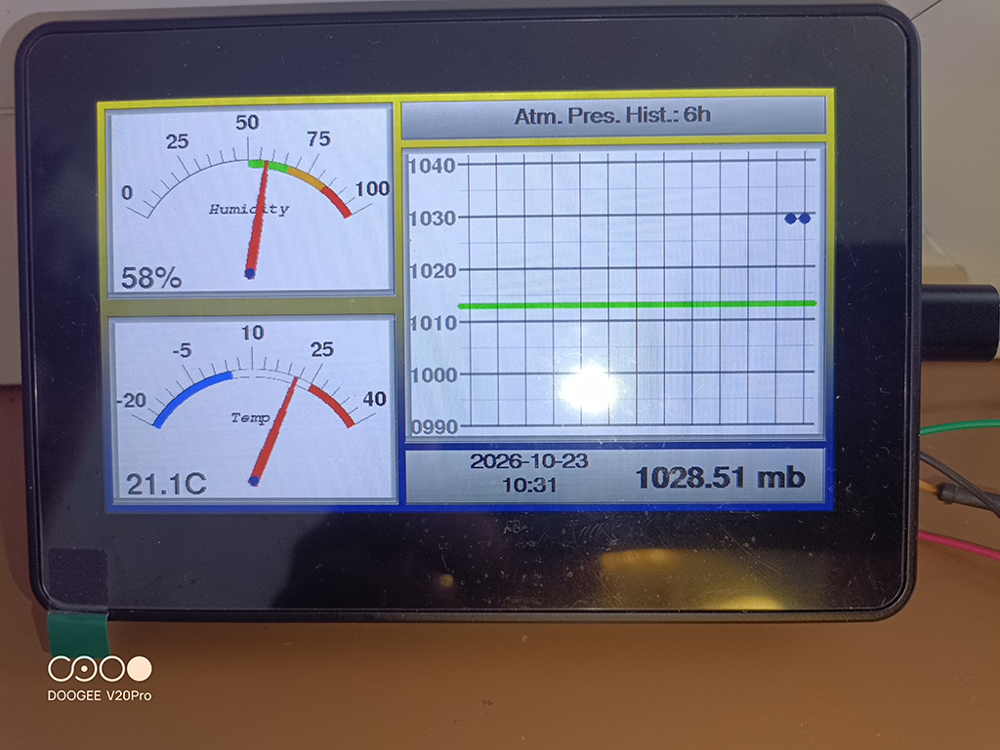
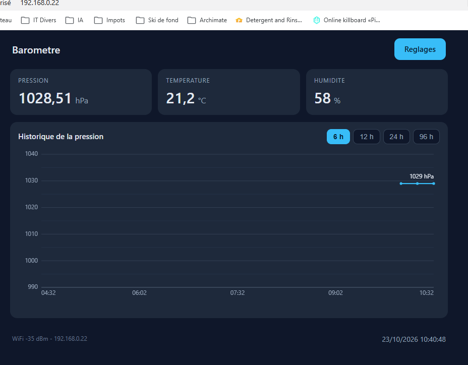

# Marine barometer

Touch barometer for **ESP32-S3**: three gauges (pressure, temperature, humidity),
three full-screen history pages, a web interface and **NMEA 2000** / **NMEA 0183**
outputs.

**Language:** [Français](README.fr.md) | English

The project runs on a **Waveshare ESP32-S3-Touch-LCD-4.3B** board (800 × 480
colour panel, GT911 capacitive touch, PCF85063A clock) with a **BME280** sensor
on the board's I²C bus.

## Screenshots

| Device screen | Web interface |
|:---:|:---:|
|  |  |

*The same reading on both sides: gauges and pressure history on the device, live
values and chart on the web page.*

## Contents

- [Screenshots](#screenshots)
- [Features](#features)
- [Hardware](#hardware)
- [Building](#building)
- [Dependencies](#dependencies)
- [TFT_eSPI configuration](#tft_espi-configuration)
- [Using the display](#using-the-display)
- [Web interface](#web-interface)
- [SD card](#sd-card)
- [NMEA outputs](#nmea-outputs)
- [Project structure](#project-structure)
- [Technical notes](#technical-notes)
- [License](#license)

## Features

### Display

- Three analogue gauges: pressure, temperature and humidity.
- Information bar: date, time and instantaneous pressure.
- Three full-screen history pages (humidity, temperature, pressure), opened by
  tapping the matching gauge and closed by tapping anywhere. Tapping the
  pressure chart opens the pressure history.
- History window shared by the three series: **6 h, 12 h, 24 h, 48 h or 96 h**.
  The time axis covers exactly the selected duration, with one point every
  15 min.
- Fixed temperature scale (−20 → 40 °C, or −4 → 104 °F in Fahrenheit), floating
  pressure scale over 50 hPa — the same scale as the web page — with the
  standard **1013 hPa** pressure marked by a **green line** (measurement page,
  full-screen history and web page).
- Screen standby after 5 min without a tap; the first tap wakes it up and
  returns to the measurement page. On wake, the panel is automatically
  reinitialised to put the image back in place (see "Restart Screen").
- Touch menu: temperature unit, history window, NMEA configuration, date and
  time, display restart, exit.

### Web interface

- Live values and **three history charts** (pressure, temperature, humidity),
  selected by clicking the matching card. Durations: **6 / 12 / 24 / 48 / 96 h**
  at 15 min, with the same pressure scale as the display and the green line at
  1013 hPa.
- **Bilingual French / English** interface, chosen on the settings page; the
  choice is stored in memory and only affects the web page (the board display
  stays in English).
- Settings page: language, display restart (without losing history), board
  restart, temperature unit, NMEA 0183 baud rate, humidity calibration offset,
  WiFi network, date and time, SD card logging.
- Connection to the home network, with an automatic fallback access point when
  the network is missing. Settings stored in NVS (flash memory) and reloaded at
  boot.

### NMEA

- **NMEA 2000** on the CAN bus: PGN 130316 (temperature), 130313 (humidity) and
  130314 (pressure), sent once per second.
- **NMEA 0183** on the RS485 port: `$WIXDR` sentence (humidity, temperature,
  pressure) every 10 s, baud rate selectable from 4800 to 38400, or output
  disabled.
- NMEA values are always in metric units (°C, %, bar), even when the display is
  set to Fahrenheit.

## Hardware

| Item | Detail |
|---|---|
| Board | Waveshare ESP32-S3-Touch-LCD-4.3B (ESP32-S3, 16 MB flash, OPI PSRAM) |
| Panel | RGB 800 × 480, driven by `ESP32_Display_Panel` |
| Touch | GT911 (I²C), CH422G expander for backlight and inputs |
| Sensor | BME280 (pressure, temperature, humidity) on the internal I²C bus |
| Clock | PCF85063A (0x51) on the board, or DS3231 (0x68), otherwise software clock |
| NMEA 0183 | RS485, GPIO 44 (TX) and 43 (RX) |
| NMEA 2000 | CAN through TWAI, GPIO 15 (TX) and 16 (RX), external CAN transceiver |

## Building

### Getting the project

```bash
git clone https://github.com/Soleiado/Barometre_marin.git
```

### Arduino IDE

1. Install the **esp32** core (3.3.12 tested) from the boards manager, adding
   the URL `https://espressif.github.io/arduino-esp32/package_esp32_index.json`.
2. Install the libraries listed below.
3. Select the **ESP32S3 Dev Module** board with:
   - **Flash Size**: 16 MB
   - **PSRAM**: OPI PSRAM
   - **Partition Scheme**: 3 MB APP / 9 MB FAT
4. Open `Barometre_marin.ino` and upload.

The `build_opt.h` file in the project is required: it defines
`CONFIG_SPIRAM_SUPPORT`, a symbol TFT_eSPI 2.5.43 still tests to allocate
sprites in PSRAM (without it, the 800 × 480 canvas cannot be created).

### arduino-cli

```bash
arduino-cli core install esp32:esp32@3.3.12

arduino-cli compile \
  --fqbn "esp32:esp32:esp32s3:FlashSize=16M,PSRAM=opi,PartitionScheme=app3M_fat9M_16MB" \
  --output-dir build .

arduino-cli upload -p COM8 \
  --fqbn "esp32:esp32:esp32s3:FlashSize=16M,PSRAM=opi,PartitionScheme=app3M_fat9M_16MB" \
  --input-dir build .
```

## Dependencies

Versions with which the project was compiled and tested:

| Library | Version | Role |
|---|---|---|
| `esp32:esp32` (Arduino-ESP32) | 3.3.12 | ESP32-S3 core (IDF 5.4), WiFi, WebServer, Preferences, TWAI |
| [ESP32_Display_Panel](https://github.com/esp-arduino-libs/ESP32_Display_Panel) | 1.0.4 | RGB panel, GT911 touch and CH422G driver |
| [esp-lib-utils](https://github.com/esp-arduino-libs/esp-lib-utils) | 0.3.0 | Required by ESP32_Display_Panel |
| [ESP32_IO_Expander](https://github.com/esp-arduino-libs/ESP32_IO_Expander) | 1.1.1 | Required by ESP32_Display_Panel (CH422G) |
| [TFT_eSPI](https://github.com/Bodmer/TFT_eSPI) | 2.5.43 | 800 × 480 drawing canvas in PSRAM |
| [TFT_eWidget](https://github.com/Bodmer/TFT_eWidget) | 0.0.5 | Buttons and form fields of the touch menu |
| [NMEA2000](https://github.com/ttlappalainen/NMEA2000) | 4.24.1 | NMEA 2000 stack |
| [NMEA2000_esp32](https://github.com/ttlappalainen/NMEA2000_esp32) | 1.0.3 | TWAI CAN driver (`NMEA2000_esp32_twai`) |

The other libraries used (`WiFi`, `WebServer`, `ESPmDNS`, `Preferences`, `SPI`,
`driver/i2c`) come with the esp32 core.

Install them in one command:

```bash
arduino-cli lib install \
  "ESP32_Display_Panel@1.0.4" \
  "esp-lib-utils@0.3.0" \
  "ESP32_IO_Expander@1.1.1" \
  "TFT_eSPI@2.5.43" \
  "TFT_eWidget@0.0.5" \
  "NMEA2000@4.24.1" \
  "NMEA2000_esp32@1.0.3"
```

> The project's library folder holds **no** local modifications: these are the
> published versions, unchanged.

## TFT_eSPI configuration

TFT_eSPI does not drive the panel (`ESP32_Display_Panel` does): it only provides
the drawing surface. It still has to be configured, otherwise fonts and colours
do not match.

Copy `extras/TFT_eSPI_User_Setup.h` over the `User_Setup.h` file of the TFT_eSPI
library folder. The lines that matter:

```c
#define ST7796_DRIVER      // reference geometry, the canvas is created at 800x480
#define TFT_BL   5
#define SPI_FREQUENCY  27000000
#define LOAD_GLCD
#define LOAD_FONT2         // small labels
#define LOAD_FONT4         // body text
#define LOAD_FONT6         // large digits
#define LOAD_FONT7
#define LOAD_FONT8
#define LOAD_GFXFF
#define SMOOTH_FONT
```

## Using the display

| Touch zone | Effect |
|---|---|
| Grey bar at the bottom right | opens / closes the menu |
| Humidity gauge (top) | full-screen humidity history |
| Temperature gauge (bottom) | full-screen temperature history |
| Pressure chart | full-screen pressure history |
| Anywhere on a history page | back to the measurement page |

The menu stays open until **Exit**. Its entries:

| Entry | Content |
|---|---|
| Temp. Unit | Celsius / Fahrenheit (the asterisk marks the current choice) |
| Hist. Range | 6 h / 12 h / 24 h / 48 h / 96 h |
| NMEA Config. | N2K only, or NMEA 0183 at 4800 / 9600 / 19200 / 38400 baud |
| Date & Time | clock setting (day, month, year, hour, minutes) |
| Restart Screen | resets the panel without losing history (see below) |
| Exit | back to the measurement page |

## Web interface

Once WiFi is configured, the page is reachable at **http://barometre.local/** or
at the board's IP address. Without a known network, the board creates the
**Barometre** / **barometre123** access point (**http://192.168.4.1/**), where
the same page lets you enter the home network credentials.

| Page | Content |
|---|---|
| `/` | current values, history chart, settings link |
| `/params` | language, display, units, NMEA output, WiFi network, date and time, SD logging |
| `/wifi` | SSID and password entry (restarts the board) |

### JSON API

| Route | Method | Parameters | Response |
|---|---|---|---|
| `/api/data` | GET | — | pressure, temperature, humidity, unit, history mode, time, WiFi status |
| `/api/history` | GET | `h=6\|12\|24\|48\|96` | pressure / temperature / humidity series, scales, time stamp |
| `/api/diag` | GET | — | panel and network diagnostics (frames, stalls, free heap, PSRAM, RSSI) |
| `/api/panel` | GET | `display=1`, `restart=1`, `reboot=1`, `pclk=<Hz>` | panel actions |
| `/api/radio` | GET | `tx=<dBm>`, `sleep=0\|1` | WiFi transmit power and power saving |
| `/time` | POST | `dt=YYYY-MM-DDTHH:MM` | clock setting |
| `/save` | POST | `ssid`, `pass` | store the network and restart |

Example:

```bash
curl "http://barometre.local/api/data"
{"ok":1,"p":1028.13,"t":19.2,"h":61,"fh":0,"mode":6,"time":"23/10/2026 08:41:03","sta":1,"ip":"192.168.0.22","rssi":-35}
```

### Stored settings

Saved in NVS (namespace `baro`) and reloaded at boot:

| Key | Content |
|---|---|
| `ssid`, `pass` | WiFi network |
| `lang` | web interface language (0 = French, 1 = English) |
| `fah` | temperature unit (Fahrenheit when true) |
| `nmea` | NMEA 0183 baud rate (0 = N2K only) |
| `humcal` | humidity calibration offset (in %) |
| `log` | SD card logging (enabled when true) |
| `LastNodeAddress` | NMEA 2000 node address |

## SD card

The microSD (TF) slot can log the measurements. The option is **off by default**
and is only enabled from the web settings page ("SD logging" tile).

- **Format**: **FAT32** card (or FAT16 for cards ≤ 2 GB). exFAT and NTFS are not
  supported.
- **Files**: one file per day, named `AAAAMMJJ.csv`, one line appended every
  15 minutes:
  ```
  202610251430,1029.8,17.9,46
  ```
  i.e. `date/time (AAAAMMJJHHMM), pressure (mb), temperature (°C), humidity (%)`,
  comma separator, dot decimals.
- **No card**: if the option is enabled while no card is present, a message is
  shown and the option is switched back off. A card removal is detected at the
  next write (within 15 min) and also disables the option.
- **Hot insert / remove**: the card is not detected automatically. After
  inserting it, re-enable the option on the settings page.
- **Card full**: when the card reaches 90% usage, the oldest file is deleted
  (checked once per day).
- The TF slot is wired in **SPI** (MOSI = GPIO 11, SCK = GPIO 12, MISO = GPIO 13),
  the chip-select being the **EXIO4** output of the CH422G expander.

## NMEA outputs

| Output | Medium | Content | Period |
|---|---|---|---|
| NMEA 2000 | CAN / TWAI, GPIO 15 (TX) and 16 (RX) | PGN 130316 (temperature, extended range), 130313 (humidity), 130314 (pressure) | 1 s |
| NMEA 0183 | RS485, GPIO 44 (TX) and 43 (RX) | `$WIXDR`: humidity, air temperature, barometric pressure | 10 s |

Example NMEA 0183 sentence:

```
$WIXDR,H,61.0,P,AirHumidity,C,19.2,C,AirTemp,P,1.0281,B,Barometer*03
```

## Project structure

```
Barometre_marin.ino                 setup(), loop(), pages, menu, touch zones
screen.cpp / screen.h               RGB panel, TFT_eSPI canvas in PSRAM, touch, standby
meter.cpp / meter.h                 analogue gauges (needle, coloured zones)
barometer.cpp / barometer.h         history series, charts, measurement page
menu.cpp / menu.h                   touch buttons and forms
webui.cpp / webui.h                 HTTP server, HTML pages, JSON API
nmea.cpp / nmea.h                   NMEA 0183 output (RS485)
nmea2k.cpp / nmea2k.h               NMEA 2000 output (CAN / TWAI)
sdlog.cpp / sdlog.h                 SD card measurement logging
rtc_clock.cpp / rtc_clock.h         PCF85063A, DS3231 or software clock
bme280_local.cpp / bme280_local.h   in-house BME280 driver (I2C, Bosch formulas)
i2c_bus.cpp / i2c_bus.h             shared I²C bus (legacy driver, required by ESP32_Display_Panel)
datetime_local.h                    minimal DateTime type (avoids the RTClib dependency)
Definition.h                        constants: delays, ranges, page numbers
esp_panel_board_supported_conf.h    board selection for ESP32_Display_Panel
build_opt.h                         build option (canvas in PSRAM)
extras/TFT_eSPI_User_Setup.h        TFT_eSPI configuration used
docs/                               screenshots used by this documentation
README.md / README.fr.md            this documentation, in English and French
```

## Technical notes

**Vertical image shift.** The RGB panel can shift by about a hundred pixels when
the memory bus is blocked for too long (flash write, WiFi burst, canvas copy).
The measures taken to avoid it: PCLK at 16 MHz, a 20-line bounce buffer in
internal RAM, cache invalidation of that buffer, and the canvas copy split into
8-line slices. A resynchronisation is also requested automatically as soon as a
refresh takes abnormally long, and the image can be put back in place without
losing anything, from the touch menu (**Restart Screen**) or through
`/api/panel?display=1`. Waking from standby automatically triggers this reset.

**History in RAM.** The history series live in RAM and are lost at every
restart: a single buffer of 384 measurements (96 h at one measurement every
15 min) per quantity, from which the 6 / 12 / 24 / 48 / 96 h views are sliding
windows. No periodic flash write, which would interrupt the panel refresh;
long-term archiving goes through the SD card (see above).

**Canvas in PSRAM.** The whole interface is drawn in an 800 × 480 TFT_eSPI sprite
(768 KB) placed in PSRAM, then copied into the panel buffer.

**WiFi and the panel.** WiFi transmission disturbs the panel: the power is
reduced to 8.5 dBm and `WIFI_PS_MAX_MODEM` power saving is used. Web page
latency increases slightly (about 0.4 s), which remains comfortable.

**No accented characters in the sources.** The embedded fonts and the layout are
designed for ASCII, so the on-screen texts avoid accented characters.

**Bilingual web interface.** Each page is written once: texts are replaced at
send time (main page) or read from a French/English table for the pages built
dynamically. No page is duplicated in the binary.

**In-house BME280 driver.** The sensor is read by a small dedicated driver (I2C
only): the bus is owned by the "legacy" ESP-IDF driver installed by
ESP32_Display_Panel, with which `Wire` cannot coexist. The compensation
formulas are those published by Bosch Sensortec (BSD-3-Clause, copyright kept
in `bme280_local.cpp`); the rest of the driver is under MIT, like the project.

## License

Released under the **MIT** license. See the [LICENSE](LICENSE) file.
